# Fluxogramas — Immersive Petroleum 1.7.10 (Forbidden Backport)

> Todos os diagramas são **Mermaid** (renderizam direto no GitHub) e foram validados com o `mmdc` antes da publicação. Cópias renderizadas em SVG e o código-fonte `.mmd` de cada um estão em [`diagrams/`](diagrams/). Dados de apoio: [`CRONOLOGIA.md`](CRONOLOGIA.md) e [`data/`](data/).

| # | Diagrama | Pergunta que responde |
|--:|---|---|
| 1 | [Linhagem de versões e commits](#1-linhagem-de-versões-e-commits-git) | Como o histórico git evoluiu, onde estão as tags e o ramo lateral? |
| 2 | [Linha do tempo (Gantt)](#2-linha-do-tempo-gantt) | Em que dias/horas cada fase aconteceu? |
| 3 | [Progressão do progresso estimado](#3-progressão-da-estimativa-global) | Como a estimativa global evoluiu? |
| 4 | [Portões de aprovação G0–G11](#4-portões-de-aprovação-g0g11) | Em que estado está cada portão? |
| 5 | [Ciclo de qualidade por funcionalidade](#5-ciclo-de-qualidade-por-funcionalidade) | Como uma família de máquinas é aprovada? |
| 6 | [Hierarquia de fontes de verdade](#6-hierarquia-de-fontes-de-verdade) | Em quem confiar quando as fontes divergem? |
| 7 | [Arquitetura em camadas](#7-arquitetura-em-camadas) | Como o mod está estruturado? |
| 8 | [Jornada das famílias de funcionalidade](#8-jornada-das-famílias-de-funcionalidade) | O que existe, em que ordem de dependência e com qual status? |
| 9 | [Planejado × realizado](#9-planejado--realizado-roadmap-de-1209-vs-estado-de-1509) | O roadmap de 12/09 foi ultrapassado? |
| 10 | [Onde está cada coisa hoje](#10-mapa-do-estado-atual-git-worktrees-documentos) | Onde retomar o trabalho? |

---

## 1. Linhagem de versões e commits (git)

Linha principal (`master` no repositório de trabalho, aqui `main`) com as 11 tags `0.1.0-alpha.N`. O ramo lateral `potion-id` representa `42b568f`, criado a partir de `2aed5b5` e **reaplicado** na linha principal como `a4182f9`. O diretório de trabalho do projeto está parado em `42b568f`, não na ponta `2c7b3f9`.

```mermaid
gitGraph
   commit id: "fd97d51" tag: "alpha.0"
   commit id: "3dd5dcf" tag: "alpha.1"
   commit id: "598ee10" tag: "alpha.2"
   commit id: "42f1239" tag: "alpha.3"
   commit id: "3d4ba53" tag: "alpha.4"
   commit id: "cf4364b" tag: "alpha.5"
   commit id: "67e5ab0" tag: "alpha.6"
   commit id: "64d7932" tag: "alpha.7"
   commit id: "759d3a5" tag: "alpha.8"
   commit id: "cff03f9" tag: "alpha.9"
   commit id: "dc6587d" tag: "alpha.10"
   commit id: "db6b77d" tag: "handoff 12/09"
   commit id: "6339c71"
   commit id: "6475315"
   commit id: "9ad549c"
   commit id: "c23571f"
   commit id: "16e7bab"
   commit id: "926c17e"
   commit id: "2aed5b5"
   branch potion-id
   checkout potion-id
   commit id: "42b568f"
   checkout main
   commit id: "7f86f4d"
   commit id: "fbcb919"
   commit id: "3d645b5"
   commit id: "5bd89e5"
   commit id: "a4182f9"
   commit id: "58f7b7b"
   commit id: "23e45b2"
   commit id: "56ea3a5"
   commit id: "c197971"
   commit id: "7672529"
   commit id: "f717ba5"
   commit id: "b19fd88"
   commit id: "59e2d9c"
   commit id: "0b7ac71"
   commit id: "e898344"
   commit id: "1ec598d" tag: "base do JAR em uso"
   commit id: "9879cdc"
   commit id: "2c7b3f9" tag: "ponta 15/09"
```

## 2. Linha do tempo (Gantt)

Horários reais de commit (UTC−03:00) agrupados por fase; a duração de cada barra vai do primeiro ao último commit da fase.

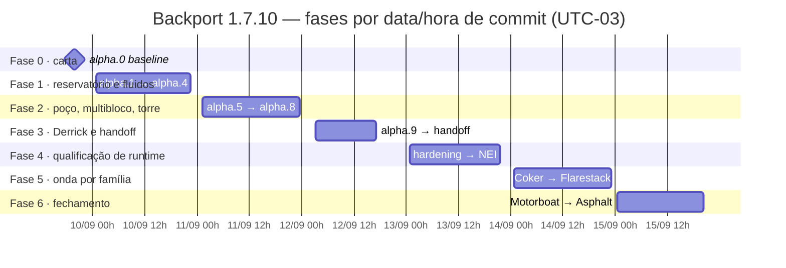

## 3. Progressão da estimativa global

Estimativa de engenharia do projeto (`TOTAL-PROGRESS.md`), em %. **Não** é medida de linhas, commits ou testes. Cada ponto é um checkpoint documentado; a faixa de incerteza é sempre de ±6–7 pontos (ver [`data/progress-estimates.tsv`](data/progress-estimates.tsv)).

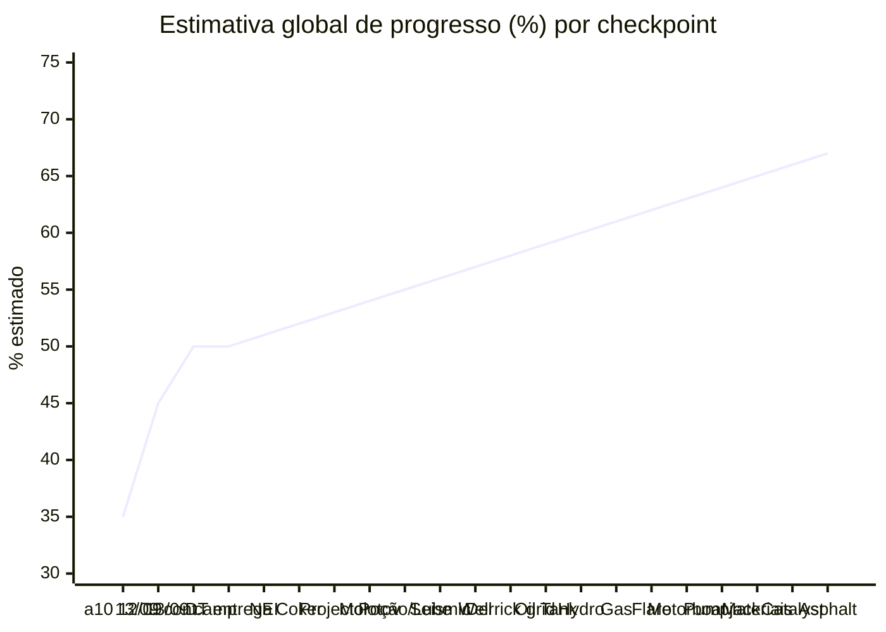

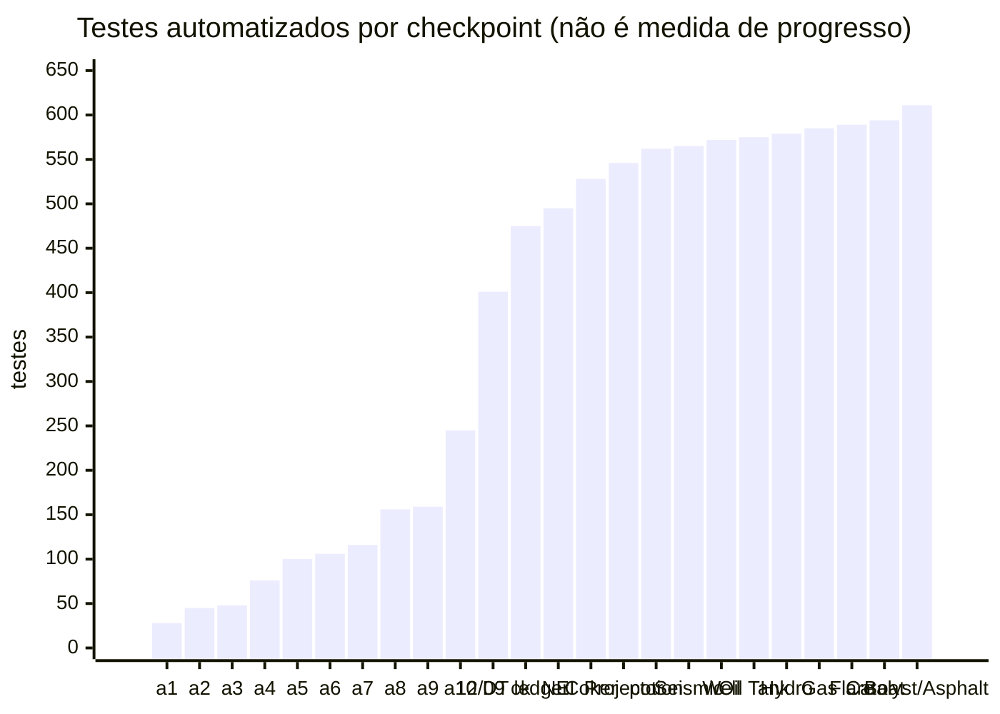

## 4. Portões de aprovação G0–G11

Estado conforme `ROADMAP.md` / `AUDIT-STATUS.md` (12/09) **atualizado** com os documentos de qualificação de 13–15/09. Verde = PASS no laboratório de desenvolvimento; amarelo = parcial ou pendente de homologação real; cinza = planejado/bloqueado. "PASS" aqui nunca significa homologado em pacote ou mundo de produção.

```mermaid
flowchart LR
    G0["G0 Congelamento de evidências<br/>PASS · 161/161 hashes"]:::pass --> G1["G1 Build reprodutível<br/>PASS · classe major 52"]:::pass
    G1 --> G2["G2 Runtime esqueleto<br/>PARCIAL · servidor+cliente OK<br/>mundo real BLOQUEADO"]:::part
    G2 --> G3["G3 Reservatório + storage<br/>PASS · G3A/G3B"]:::pass
    G3 --> G4["G4 Fundação / Pumpjack<br/>PASS exceto G4B3B arte final"]:::part
    G4 --> G5["G5 Distillation Tower<br/>PASS exceto G5C2 UX/arte final"]:::part
    G5 --> G6["G6 Extração moderna<br/>Derrick, Seismic, Well, Oil Tank<br/>PASS em laboratório"]:::part
    G6 --> G7["G7 Processamento moderno<br/>Coker, Hydro, Catalyst, Gas, Lube, Flare<br/>PASS em laboratório"]:::part
    G7 --> G8["G8 Mobilidade / construção<br/>Motorboat, Projector, Asphalt, Molotov<br/>PASS em laboratório"]:::part
    G8 --> G9["G9 Matriz de compatibilidade<br/>NÃO INICIADO (pack real)"]:::plan
    G9 --> G10["G10 Performance / soak / corrupção<br/>NÃO INICIADO"]:::plan
    G10 --> G11["G11 Release candidate<br/>BLOQUEADO · licença/assets"]:::block
    classDef pass fill:#d4edda,stroke:#2e7d32,color:#111
    classDef part fill:#fff3cd,stroke:#b8860b,color:#111
    classDef plan fill:#e9ecef,stroke:#6c757d,color:#111
    classDef block fill:#f8d7da,stroke:#b02a37,color:#111
```

## 5. Ciclo de qualidade por funcionalidade

Adaptação do fluxo de `DELIVERY-PLAN.md`. Três papéis: o **dono da implementação** integra; um **revisor independente** procura contraexemplos concretos; o **aprovador** avalia a evidência salva. Observação honesta: no projeto, esses papéis foram exercidos pelo mesmo assistente em contextos separados — **não houve auditoria externa independente**.

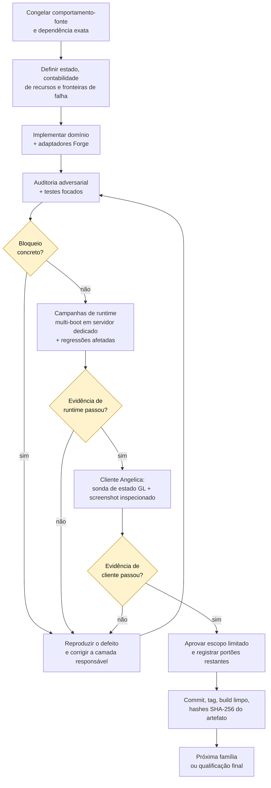

Regras que acompanham o ciclo: compilar ≠ estar correto; asserções nunca são enfraquecidas para passar; evidência rejeitada é preservada (não apagada); percentual nunca é derivado do número de testes; um portão que falhou só volta a PASS quando a reprodução e as regressões passam; achados tardios **reabrem** portões já aprovados.

## 6. Hierarquia de fontes de verdade

Quando duas fontes divergem, vence a de cima (carta do projeto, 09/09).

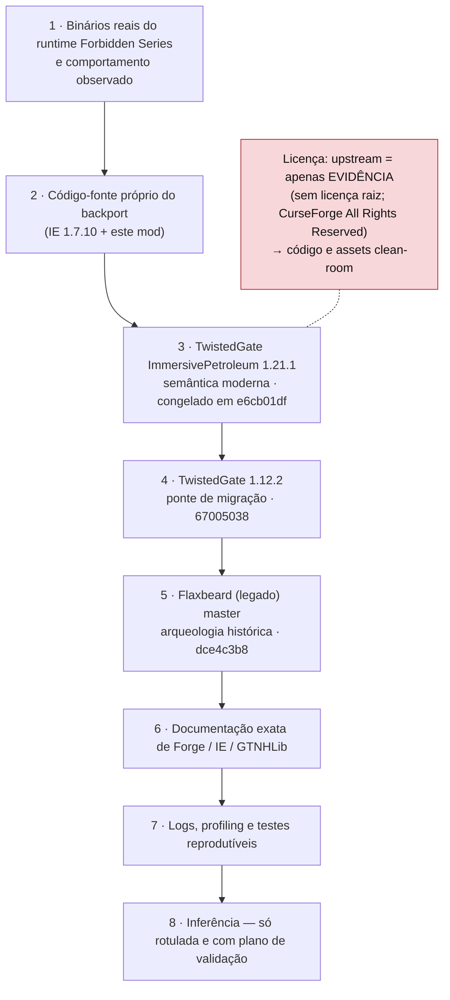

## 7. Arquitetura em camadas

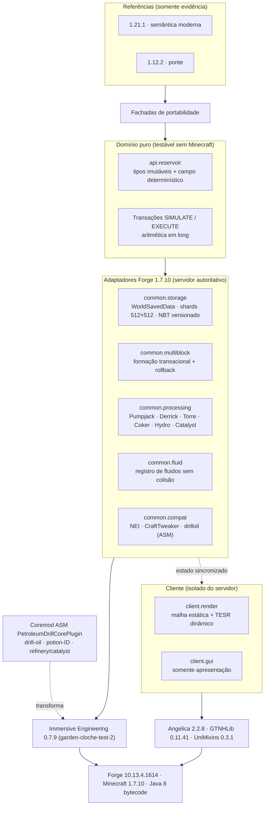

## 8. Jornada das famílias de funcionalidade

Camadas de entrega de `FEATURE-MATRIX.md` ("Release tiers") com o estado em 15/09. Cor: **azul** = fundação (alpha.0–10, empacotada); **verde** = qualificada em laboratório depois de 12/09 (campanha de runtime + cliente Angelica); **amarelo** = existe mas ficou com lacuna conhecida. Nenhuma está homologada em pack/multiplayer reais.

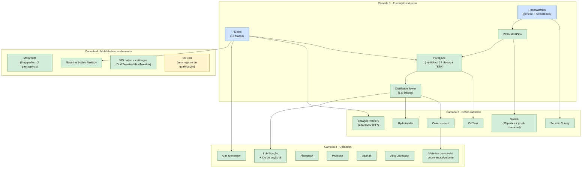

> As setas mostram **dependência de domínio** (o que precisa existir antes), não a ordem em que o código foi escrito. A ordem cronológica está em [`CRONOLOGIA.md`](CRONOLOGIA.md). Lacunas ainda abertas por família: [`ESTADO-ATUAL-E-RETOMADA.md`](ESTADO-ATUAL-E-RETOMADA.md).

## 9. Planejado × realizado (roadmap de 12/09 vs. estado de 15/09)

O `ROADMAP.md` empacotado no checkpoint de 12/09 listava G7 e G8 como "PLANNED". Em 3 dias de trabalho (13–15/09) a primeira passada de todas essas famílias foi concluída **em laboratório**:

| Portão | Escopo no roadmap (12/09) | Situação em 15/09 | Evidência |
|---|---|---|---|
| G6 Extração moderna | Derrick (parcial), Seismic, Oil Tank, migração de versão | Derrick + grade direcional, Seismic, Well, Oil Tank qualificados | docs `2026-09-14-*` |
| G7 Processamento moderno | Coker, Hydrotreater, Gas Generator, Lubrificação, Auto Lubricator, Oil Can, Flarestack | Coker custom, Hydro, Gas, Lubrificação, Flarestack, Catalyst Refinery qualificados; Auto Lubricator re-executado nos testes de colocação compartilhada · **Oil Can sem registro de qualificação; FEATURE-MATRIX sem linhas atualizadas para Auto Lubricator/Coker/Molotov/DT** | commits `fbcb919`…`9879cdc` |
| G8 Mobilidade / construção | Motorboat, Projector, Asphalt, petcoke/cera/Molotov | Motorboat (moderno), Projector, Asphalt, Molotov, cadeia de materiais qualificados | commits `0b7ac71`…`2c7b3f9` |
| G9 Compatibilidade | Matriz de pack exato | **Não iniciado** | — |
| G10 Performance/soak | 1/16/64/256 máquinas, corrupção | **Não iniciado** | — |
| G11 Release candidate | Licença, manifesto, known-issues | **Bloqueado** (gate de licença/assets) | `ROADMAP.md` |

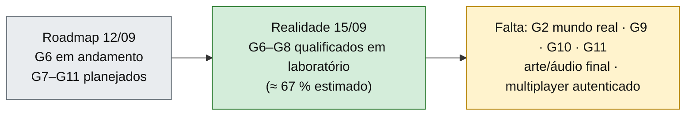

## 10. Mapa do estado atual (git, worktrees, documentos)

Onde está cada coisa no disco local no momento da investigação (25/10/2026). Detalhes e comandos em [`ESTADO-ATUAL-E-RETOMADA.md`](ESTADO-ATUAL-E-RETOMADA.md).

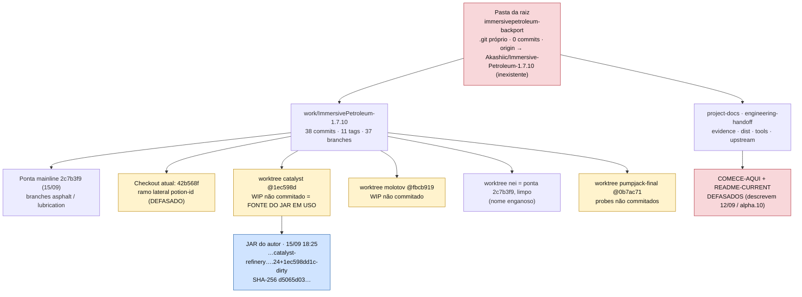
