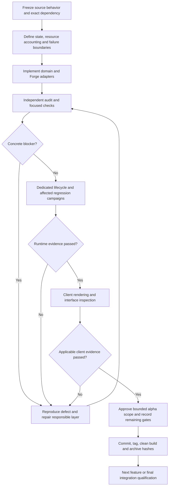

# Delivery plan - modern Petroleum on Forge 1.7.10

Date: 2026-09-12

## Scope and evidence

The objective remains the complete modern industrial and vehicle feature set, with original detailed art, animation, sound and practical pack integration. Alpha checkpoints approve only their recorded scope. No completion percentage substitutes for an acceptance test.

Baseline: alpha.9 / cff03f9. Existing Derrick work is being integrated and independently reviewed. Production modpack binaries and worlds are not development targets.

## Sequence and decisions

1. Derrick foundation: audit drilling and pressure accounting, grid validation, versioned NBT and concrete registry collisions. Reject malformed data before world integration.
2. Derrick runtime: physical/virtual drilling, pressure extraction, pipe inventory, CoFH/Forge ports, bounded Well lookup, transactional formation and restart/break/reform. Provide a usable container and diagnostic status. Directional grid editing receives separate server authorization and packet bounds tests.
3. Extraction journey: Seismic Survey and reservoir results, Derrick configuration, pressure phase, Pumpjack handover, Oil Tank and copied-world migration. Demonstrate a survival journey without diagnostic fixtures.
4. Refinery journey: Coker AND Hydrotreater, complete material and fraction recipes, automation and backpressure, NEI/manual/CraftTweaker integration. Verify recipe accounting and throughput against the frozen upstream.
5. Utilities: Gas Generator, lubrication handlers, Auto Lubricator, Oil Can, Flarestack, Projector and asphalt. Isolate optional pack adapters and test their absence.
6. Mobility and remaining materials: Motorboat/upgrades, gasoline bottles/Molotov, petcoke and wax families. Audit server movement/interaction authority and lifecycle of vehicle sounds.
7. Premium presentation: independently created final models/textures, mechanical animation, original positional sound, bounded particles, resource reload and shader compatibility. Early renderer foundations are not final art approval.
8. Release qualification: copied production world, full modpack compatibility, dedicated multiplayer, chunk unload/reload, crash/corruption, machine-count profiling, long-run accounting, upgrade/rollback instructions and signed artifact manifest.

Each step follows source evidence -> implementation -> adversarial review -> focused checks -> runtime -> artifact identity. A failed gate remains failed until its reproduction passes and affected regressions pass.

The implementation owner integrates changes; an independent reviewer looks for concrete counterexamples; the delivery approver evaluates the saved evidence. Review completion alone cannot approve runtime behavior. Later findings reopen affected gates, including features accepted in earlier alphas. The covered-IE-pipe duplication found during Derrick review therefore also requires Pumpjack and Distillation regression campaigns in alpha.10.

## Performance and networking policy

- Only the canonical master ticks machine logic and renders the complete model; members retain local bounds.
- Cache derived reservoir taps by Well identity/topology revision. Never force-load chunks for a lookup or GUI request.
- No disk I/O, resource decoding, thread creation or unbounded queues in machine ticks or render callbacks.
- GUI commands execute on the server tick thread, require the live matching container and distance, and validate bounded payloads before allocation or mutation. Container inventory transactions use vanilla synchronization.
- Sound work starts with short authored assets and event-driven loops; no per-tick decoder startup or DSP allocation. Voices stop on unload, shutdown and resource reload. DSP is used only where it improves an identified sound requirement.
- Measure CPU tick time, frame time, allocations, draw volume and packet traffic separately for 1/16/64/256 machines. Keep graphics settings, world and cache conditions equal. Do not promise an unmeasured FPS improvement.
- Operational switches pause machine work while retaining registry IDs and save data.

## Library decisions

The build currently pins GTNHLib 0.11.41 and Angelica 2.2.8 dev artifacts with the exact IE 0.7.9 dependency. Validate these versions, not an assumed latest API. GTNHLib offers reusable rendering/data utilities; Angelica is a renderer compatibility target. Hodgepodge, ArchaicFix and CoreTweaks address different engine issues and are not substitutes for bounded machine code. UniMixins is reserved for a demonstrated API gap. GeckoLib, EntityCulling and ParallelMipMap are not new mandatory dependencies; inspect the exact installed implementation and test a concrete use case before adopting one. Culling must preserve whole-machine visibility; mipmap processing does not prove lower server tick cost.

Reference documentation consulted 2026-09-12:
- https://github.com/GTNewHorizons/GTNHLib
- https://github.com/GTNewHorizons/Angelica/blob/master/README.MD
- https://github.com/embeddedt/ArchaicFix
- https://github.com/makamys/CoreTweaks
- https://github.com/tr7zw/EntityCulling

## Current release limits

Real-world upgrade, final art, active shaderpack certification, full pack compatibility and multiplayer/performance soak remain unapproved. Preserve those limits in each alpha delivery. Recreated assets do not by themselves establish rights to redistribute unrelated upstream material.
